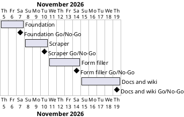

# Project Plan: House Prices Capstone

## Metadata
| Key | Value |
| --- | --- |
| ID | PP-001 |
| CrossReference | [BC-001], [SA-001], [MIL-001], [MIL-002], [MIL-003], [MIL-004] |
| Language | en |
| Domain | it |

## Version History
| Date | Status | Author | Reviewer | Change | Commit |
| --- | --- | --- | --- | --- | --- |
| 2026-11-05 | Accepted | Jens Tirsvad Nielsen | AI as stand-in for S01 | Initial version | pending |

---

## Purpose

This plan schedules the four gateways that deliver the House Prices Capstone inside the Business Case constraint of two weeks, 2026-11-05 to 2026-11-19 ([BC-001] Constraints).

## Planning Assumptions

- The plan starts 2026-11-05 and ends 2026-11-19, per the Business Case constraint.
- A gateway lasts two to five days; each ends with a pull request from its own branch and a Go/No-Go decision by S01 ([SA-001] CR-001).
- The assignment text is the requirement for the program. Its behaviour is fixed by the assignment, with one actor, so all tasks are technical tasks and need no use case or user story (see Stories below).
- Code is written by the `python-developer` agent under the Python rules of the project, only after the milestone that holds the task is `Accepted` with a `Go` review.
- Autonomous mode: the AI acts as stand-in for S01 as reviewer, and each review record says `Mode: autonomous, not independent`.
- The wiki gateway is last so that a slip in translation never blocks the code ([SA-001] conflict 1).

## Gateway Schedule

| Gateway | Document | Window | Decision date | Owner | Stories | Main deliverable | Milestone |
| --- | --- | --- | --- | --- | --- | --- | --- |
| Foundation | [MIL-001] | 2026-11-05 to 2026-11-07 | 2026-11-07 | S01 | none (technical tasks) | Project skeleton, tooling, README, `.gitignore`, Doxyfile, repository description and topics | not yet synced |
| Scraper | [MIL-002] | 2026-11-08 to 2026-11-10 | 2026-11-10 | S01 | none (technical tasks) | Tested scraper returning clean lists of links, prices and addresses | not yet synced |
| Form filler | [MIL-003] | 2026-11-11 to 2026-11-14 | 2026-11-14 | S01 | none (technical tasks) | Selenium form filler, container setup, filled Google Form and Sheet | not yet synced |
| Docs and wiki | [MIL-004] | 2026-11-15 to 2026-11-19 | 2026-11-19 | S01 | none (technical tasks) | Final README, three-language wiki with screenshots, Doxygen run | not yet synced |



## Scope Coverage

| Business Case scope item | Gateway |
| --- | --- |
| Scraping links, prices and addresses with `requests` and BeautifulSoup | [MIL-002] |
| Filling a Google Form with Selenium, one response per listing | [MIL-003] |
| Project structure, `pyproject.toml`, `constants.py`, `.gitignore`, Doxyfile and Doxygen comments | [MIL-001] (structure, Doxyfile), [MIL-002] and [MIL-003] (comments in the code they add), [MIL-004] (Doxygen run) |
| Unit tests with `pytest` against a saved copy of the page | [MIL-001] (toolchain), [MIL-002], [MIL-003] |
| README with run and test instructions and a screenshot per lecture step | [MIL-001] (instructions), [MIL-004] (screenshots) |
| Wiki in English, Danish and Bahasa Malaysia with a screenshot per step | [MIL-004] |
| Repository description and topics on the git host | [MIL-001] |

## Dependencies

```
MIL-001 → MIL-002 → MIL-003 → MIL-004
```

A No-Go at a gateway stops the later gateways. The rework is done inside the same window if it takes at most two days; otherwise all later dates move by the rework time. The end date 2026-11-19 moves only if S01 decides it, in chat, and the Business Case is amended with a new Version History row.

## Plan Risks

| Risk | Impact | Mitigation |
| --- | --- | --- |
| The Google Form needs S01's sign-in (Business Case risk 2) | MIL-003 waits for S01 | Ask for the form at the start of MIL-002 so it exists when MIL-003 begins |
| Docker is not available for the end-to-end run (Business Case risk 3) | MIL-003 cannot close | Stop and report; never fall back to the host desktop; use Windows Sandbox only if Docker stays unavailable |
| Translation takes longer than planned (Business Case risk 6) | MIL-004 slips | Write English first and translate page by page; the code gateways are already done |
| Review stand-in is not independent | A defect may pass | The summary lists every stand-in decision for S01 to challenge |

## Open Issues

- The function names of the assignment's solution are read from the gists in task 1 of [MIL-002]; they are not known yet.
- The Google Form does not exist yet; S01 creates it in task 1 of [MIL-003].
- The user named the repository as `Tirsvad-Udemy-100_days_of_code`; the configured `origin` is `Tirsvad-Udemy-100-days-of-code/053-capstone-house-prices` and the host redirects the first name to the second organisation, so the plan uses `origin`.

---

[BC-001]: ./business-case.md
[SA-001]: ./stakeholder-analysis.md
[MIL-001]: ./milestones/mil-001-foundation.md
[MIL-002]: ./milestones/mil-002-scraper.md
[MIL-003]: ./milestones/mil-003-form-filler.md
[MIL-004]: ./milestones/mil-004-docs-wiki.md
